# AI-Assisted Development Guide

```mermaid
%%{init: {
  'theme': 'base',
  'themeVariables': {
    'background': '#f0f2f5',
    'primaryColor': '#dbeafe',
    'primaryBorderColor': '#3b82f6',
    'primaryTextColor': '#1e293b',
    'secondaryColor': '#dcfce7',
    'secondaryBorderColor': '#22c55e',
    'tertiaryColor': '#fef9c3',
    'tertiaryBorderColor': '#f59e0b',
    'lineColor': '#94a3b8',
    'fontSize': '14px'
  }
}}%%
flowchart TD
    %% ─── INPUTS ───────────────────────────────────────────────
    EXT1([Business Requirements\nfrom Domain Experts])
    EXT2([Legacy Systems])

    %% ─── PHASE: ANALYSIS ──────────────────────────────────────
    subgraph ANALYSIS ["🔍 ANALYSIS"]
        direction TB

        subgraph A1 ["Step 1 · Business Requirements Gathering"]
            direction LR
            A1_TOOL["🛠 BMAD Method\n─────────────────────\nAgents\n• bmad-help\n• agent-analyst\n• bmad-agent-pm\n• bmad-agent-tech-writer\n─────────────────────\nResearch\n• bmad-brainstorming\n• bmad-domain-research\n• bmad-prfaq\n• bmad-product-brief\n─────────────────────\nPRD Lifecycle\n• bmad-create-prd\n• bmad-edit-prd\n• bmad-validate-prd"]
        end

        A1_OUT[/"📄 Product Requirements\nDocument — PRD"/]

        subgraph A2 ["Step 2 · Feature Specification Generation"]
            direction LR
            A2_TOOL["🛠 Spec-Kit\n─────────────────────\n/speckit-constitution\n→ Project principles\n─────────────────────\n/speckit-specify\n→ Feature specs\n─────────────────────\n/speckit-clarify\n→ Resolve ambiguities"]
        end

        A2_OUT[/"📂 Feature Spec Files"/]
    end

    %% ─── PHASE: DESIGN ────────────────────────────────────────
    subgraph DESIGN ["🎨 DESIGN"]
        direction TB

        subgraph D1 ["Step 1 · Interactive UX Mockup Generation"]
            D1_TOOL["🛠 Figma Make\n─────────────────────\nUX/UI Designer drives\ngeneration from specs"]
        end

        D1_OUT[/"🖼 Interactive UX Mockups"/]

        subgraph D2 ["Step 2 · Review & Refine UX Mockups"]
            D2_TOOL["🛠 Figma Make + Figma\n─────────────────────\nMinor edits → Figma copy-paste\nMajor changes → update specs\nthen regenerate\nStakeholder comments in Figma/Figma Make"]
        end

        D2_OUT[/"✅ Approved Interactive\nUX Mockups"/]

        subgraph D3 ["Step 3 · Finalize Figma UI Design"]
            D3_TOOL["🛠 Figma\n─────────────────────\nApply pre-defined Design System\nCritical input for Development phase"]
        end

        D3_OUT[/"🎨 Approved Figma\nUI Design Files"/]
    end

    %% ─── PHASE: DEVELOPMENT ───────────────────────────────────
    subgraph DEVELOPMENT ["⚙️ DEVELOPMENT"]
        direction TB

        subgraph DEV1 ["Step 1 · Implementation Planning"]
            DEV1_TOOL["🛠 Spec-Kit\n─────────────────────\n/speckit-checklist\n→ Custom checklist\n─────────────────────\n/speckit-plan\n→ Design artifacts\n─────────────────────\n/speckit-tasks\n→ tasks.md"]
        end

        DEV1_OUT[/"📋 Implementation Plans\n& tasks.md"/]

        subgraph DEV2 ["Step 2 · Task Implementation"]
            DEV2_TOOL["🛠 Spec-Kit + SuperPowers\n─────────────────────\nSpec-Kit for planning\nSuperpowers for execution\nHandoff prompt triggers TDD\nDo NOT let Superpowers re-plan"]
        end

        DEV2_OUT[/"💻 Backend + Frontend\nImplementation Code"/]

        subgraph DEV3 ["Step 3 · Manual Code Review"]
            DEV3_TOOL["👤 Manual Review\n─────────────────────\nBackend dev → backend\nFrontend dev → frontend"]
        end

        DEV3_OUT[/"✅ Reviewed &\nApproved Code"/]
    end

    %% ─── PHASE: TESTING ───────────────────────────────────────
    subgraph TESTING ["🧪 TESTING"]
        direction TB

        subgraph T1 ["Step 1 · Build Test Cases"]
            T1_TOOL["🛠 Agentic IDE\n─────────────────────\nDriven from feature specs"]
        end

        T1_OUT[/"🗒 Test Cases"/]

        subgraph T2 ["Step 2 · Implement Test Cases"]
            T2_TOOL["🛠 Agentic IDE\n─────────────────────\nTest cases + Approved code"]
        end

        T2_OUT[/"🧩 Implemented Tests"/]

        subgraph T3 ["Step 3 · Run Tests & Log Bugs"]
            T3_TOOL["▶ Test Runner\n─────────────────────\nExecute test suite\nLog all failures"]
        end

        T3_OUT[/"🐛 Bug Reports"/]

        subgraph T4 ["Step 4 · Verify Resolved Bugs"]
            T4_TOOL["✔ Verification\n─────────────────────\nConfirm fixes against\noriginal bug reports"]
        end

        T4_OUT[/"✅ Verified Fixes"/]
    end

    %% ─── EDGES: INPUTS → ANALYSIS ─────────────────────────────
    EXT1 --> A1_TOOL
    EXT2 --> A1_TOOL
    A1_TOOL --> A1_OUT
    A1_OUT --> A2_TOOL
    A2_TOOL --> A2_OUT

    %% ─── EDGES: ANALYSIS → DESIGN ─────────────────────────────
    A2_OUT --> D1_TOOL
    D1_TOOL --> D1_OUT
    D1_OUT --> D2_TOOL
    D2_TOOL --> D2_OUT
    D2_OUT --> D3_TOOL
    D3_TOOL --> D3_OUT

    %% ─── EDGES: DESIGN → DEVELOPMENT ─────────────────────────
    A2_OUT -->|"Feature specs\nalso feed Dev"| DEV1_TOOL
    D3_OUT --> DEV1_TOOL
    DEV1_TOOL --> DEV1_OUT
    DEV1_OUT --> DEV2_TOOL
    DEV2_TOOL --> DEV2_OUT
    DEV2_OUT --> DEV3_TOOL
    DEV3_TOOL --> DEV3_OUT

    %% ─── EDGES: ANALYSIS → TESTING (spec feed) ────────────────
    A2_OUT -->|"Feature specs\nalso feed Testing"| T1_TOOL

    %% ─── EDGES: DEVELOPMENT → TESTING ─────────────────────────
    T1_TOOL --> T1_OUT
    T1_OUT --> T2_TOOL
    DEV3_OUT -->|"Approved code\nfeeds Test impl"| T2_TOOL
    T2_TOOL --> T2_OUT
    T2_OUT --> T3_TOOL
    T3_TOOL --> T3_OUT
    T3_OUT --> T4_TOOL
    T4_TOOL --> T4_OUT

    %% ─── BUG-FIX LOOP ─────────────────────────────────────────
    %%T3_OUT -->|"Bug fix loop"| DEV2_TOOL

    %% ─── STYLING ──────────────────────────────────────────────

classDef phase        fill:#dbeafe,stroke:#3b82f6,stroke-width:2px,color:#1e3a5f,rx:8
    classDef tool         fill:#f0f9ff,stroke:#0ea5e9,stroke-width:2px,color:#0c4a6e,text-align:left
    classDef artifact     fill:#dcfce7,stroke:#16a34a,stroke-width:2px,color:#14532d
    classDef external     fill:#fef3c7,stroke:#d97706,stroke-width:2px,color:#78350f
    classDef subphase     fill:#f8fafc,stroke:#64748b,stroke-width:1px,color:#334155
    
    class ANALYSIS,DESIGN,DEVELOPMENT,TESTING phase
    class A1,A2,D1,D2,D3,DEV1,DEV2,DEV3,T1,T2,T3,T4 subphase
    class A1_TOOL,A2_TOOL,D1_TOOL,D2_TOOL,D3_TOOL,DEV1_TOOL,DEV2_TOOL,DEV3_TOOL,T1_TOOL,T2_TOOL,T3_TOOL,T4_TOOL tool
    class A1_OUT,A2_OUT,D1_OUT,D2_OUT,D3_OUT,DEV1_OUT,DEV2_OUT,DEV3_OUT,T1_OUT,T2_OUT,T3_OUT,T4_OUT artifact
    class EXT1,EXT2 external
```

| Phase | Step | Activity | Tool / Kit | Input | Output | Key Skills / Notes | Refs |
|-------|------|----------|------------|-------|--------|--------------------|------|
| Analysis | 1 | Business requirements gathering | BMAD Method | Business reqs from domain experts; legacy systems | Product Requirements Document (PRD) | Agents: bmad-help, agent-analyst, bmad-agent-pm, bmad-agent-tech-writer Research: bmad-brainstorming, bmad-domain-research, bmad-prfaq, bmad-product-brief PRD Lifecycle: bmad-create-prd, bmad-edit-prd, bmad-validate-prd | https://github.com/bmad-code-org/BMAD-METHOD `npx bmad-method install --tools codex --user-name Ninja --directory . --output-folder _bmad-output --yes` https://github.com/abatal-coder/bmad-app |
| Analysis | 2 | Feature specification generation | Spec-Kit | Approved PRD | Feature spec files | `/speckit-constitution` → project principles `/speckit-specify` → feature specs `/speckit-clarify` → resolve ambiguities | https://github.com/github/spec-kit https://github.github.com/spec-kit/install/uv.html `uv tool install specify-cli --from git+https://github.com/github/spec-kit.git@v0.8.11` `specify init --here --integration cursor-agent` https://github.com/abatal-coder/spec-kit-app |
| Design | 1 | Interactive UX mockup generation | Figma Make | Feature spec files | Interactive UX mockups | UX/UI Designer drives generation from specs | |
| Design | 2 | Review & refine UX mockups | Figma Make + Figma (iterative) | Interactive UX mockups | Approved interactive UX mockups | Minor edits → Figma copy-paste; major changes → update specs then regenerate. Stakeholder comments in Figma. | |
| Design | 3 | Finalize Figma UI design | Figma | Approved UX mockups | Approved Figma UI design files | Apply pre-defined Design System. Critical input for development phase. | |
| Development | 1 | Implementation planning | Spec-Kit | Feature spec files, Figma UI design files | Implementation plans & task breakdown | `/speckit-checklist` → custom checklist `/speckit-plan` → design artifacts `/speckit-tasks` → tasks.md | |
| Development | 2 | Task implementation | Spec-Kit + SuperPowers | Implementation plans & tasks.md | Backend + frontend implementation code | Spec-Kit for planning; Superpowers for execution. Use handoff prompt to trigger TDD per task. Don't let Superpowers re-plan. | https://dev.to/truongpx396/spec-kit-vs-superpowers-a-comprehensive-comparison-practical-guide-to-combining-both-52jj |
| Development | 3 | Manual code review | — | Generated implementation code | Reviewed & approved code | Backend dev reviews backend; frontend dev reviews frontend. | |
| Testing | 1 | Build test cases | Agentic IDE | Feature spec files | Test cases | — | |
| Testing | 2 | Implement test cases | Agentic IDE | Test cases + Approved code | Implemented tests | — | |
| Testing | 3 | Run tests & log bugs | — | Implemented tests | Bug reports | — | |
| Testing | 4 | Verify resolved bugs | — | Resolved Bugs | Verified fixes | — | |
